# 📊 Employee Performance Predictor using Data Analytics

> An end-to-end HR analytics + machine learning project that **predicts whether an employee will be a Low, Medium or High performer** and turns each prediction into a concrete HR action: promotion, training or support.


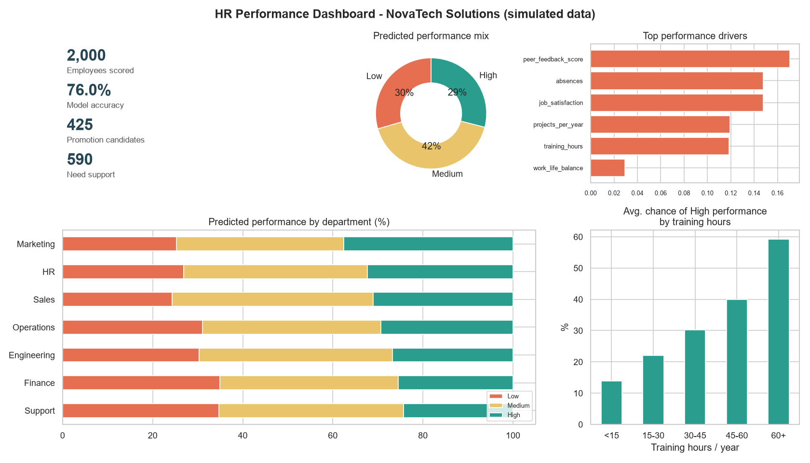

---

## 1. Project Overview

Companies spend a lot on hiring, training and promotions, yet most performance decisions are still made from gut feeling once a year. This project simulates a 2,000-employee company (**NovaTech Solutions**), analyses its HR data, and trains a classification model that predicts each employee's next performance band.

| | |
|---|---|
| **Type** | Multi-class classification (Low / Medium / High) |
| **Data** | 2,000 synthetic employees, 18 raw attributes + 4 engineered features |
| **Best model** | Logistic Regression (beat Random Forest, Gradient Boosting and Decision Tree) |
| **Test accuracy** | **76.0%** · F1-macro **0.763** on 400 unseen employees |
| **Output** | Predictions, HR action lists, insights report, dashboard |

## 2. Problem Statement

> *"Given an employee's profile, work behaviour and engagement data, can we predict their performance category early enough for HR to act?"*

Today HR teams often find low performance **after** the yearly review, when it is already costly. They also struggle to spot promotion-ready talent objectively.

## 3. Business Value

| Stakeholder | How they use it |
|---|---|
| **HR team** | Early warning list of employees who need support; data-driven training budget |
| **Managers** | Objective second opinion before promotion and appraisal decisions |
| **Leadership** | Department-level view of talent strength and risk |
| **Employees** | Personalised development plans (training, mentoring, workload review) |

**Key findings from the simulation**
- Top drivers of performance: **peer feedback, absences, job satisfaction, projects per year, training hours**.
- Employees in the top 25% for training hours are predicted High performers **49%** of the time, against **14%** for the bottom 25%.
- Working more than 220 hours a month **lowers** performance (burnout effect).
- Finance and Support have the highest share of at-risk employees (~35% predicted Low).

## 4. Tech Stack

| Layer | Tools |
|---|---|
| Language | Python 3.10+ |
| Data handling | Pandas, NumPy |
| Visualisation | Matplotlib, Seaborn |
| Machine learning | scikit-learn (Pipeline, ColumnTransformer, LogisticRegression, RandomForest, GradientBoosting, DecisionTree) |
| Model persistence | joblib |
| Dashboard | Streamlit |
| Exploration | Jupyter Notebook |

## 5. Architecture

```
 ┌──────────────────────┐
 │  Synthetic HR data   │  data_generator.py  (virtual company, 2,000 employees,
 │  (CSV, messy)        │                      injected missing values/outliers/dupes)
 └──────────┬───────────┘
            ▼
 ┌──────────────────────┐
 │  Data cleaning       │  preprocessing.clean_data()
 │  + feature eng.      │  preprocessing.engineer_features()
 └──────────┬───────────┘
            ▼
 ┌──────────────────────┐       ┌──────────────────────┐
 │  EDA (6 charts)      │       │  Train/test split     │ 80 / 20 stratified
 │  eda.py              │       └──────────┬───────────┘
 └──────────────────────┘                  ▼
                               ┌──────────────────────┐
                               │ Model comparison      │ 4 models x 5-fold CV
                               │ train.py              │ → best saved (.joblib)
                               └──────────┬───────────┘
                                          ▼
                               ┌──────────────────────┐
                               │ Evaluation            │ accuracy, F1, confusion
                               │ evaluate.py           │ matrix, feature importance
                               └──────────┬───────────┘
                                          ▼
 ┌──────────────────────┐      ┌──────────────────────┐
 │ New employees (CSV)  │ ───► │ Prediction + HR rules │ predict.py
 └──────────────────────┘      └──────────┬───────────┘
                                          ▼
                 ┌──────────────────────────────────────────┐
                 │ HR insights report · action lists ·       │ insights.py
                 │ PNG dashboard · Streamlit app (app.py)    │
                 └──────────────────────────────────────────┘
```

## 6. Folder Structure

```
Employee-Performance-Predictor/
├── data/
│   ├── raw/                 # generated messy data + new employees to score
│   └── processed/           # cleaned data with engineered features
├── docs/                    # full project guide, GitHub guide, interview prep
├── images/                  # all charts (EDA, confusion matrix, dashboard)
├── models/                  # trained model (best_model.joblib)
├── notebooks/               # step-by-step walkthrough notebook
├── outputs/                 # metrics, reports, predictions, HR action lists
├── src/
│   ├── config.py            # paths, settings, feature lists
│   ├── data_generator.py    # virtual company simulation
│   ├── preprocessing.py     # cleaning + feature engineering + sklearn transformer
│   ├── eda.py               # exploratory charts
│   ├── train.py             # model comparison + training
│   ├── evaluate.py          # metrics, confusion matrix, feature importance
│   ├── insights.py          # HR report, action lists, dashboard image
│   └── predict.py           # predictions + HR recommendations
├── app.py                   # Streamlit dashboard
├── main.py                  # runs the whole pipeline
├── requirements.txt
└── README.md
```

## 7. How to Run

```bash
# 1. Clone
git clone https://github.com/SNischayPrasad/Employee-Performance-Predictor.git
cd Employee-Performance-Predictor

# 2. Create & activate a virtual environment
python -m venv venv
venv\Scripts\activate          # Windows
source venv/bin/activate       # Mac / Linux

# 3. Install dependencies
pip install -r requirements.txt

# 4. Run the full pipeline (≈1-2 minutes)
python main.py

# 5. (Optional) Launch the interactive dashboard
streamlit run app.py

# 6. (Optional) Predict for your own CSV
python -m src.predict --input data/raw/new_employees.csv
```

## 8. Results

### Model comparison (5-fold cross-validation on training data)

| Model | CV Accuracy | CV F1-macro |
|---|---|---|
| **Logistic Regression** | **0.758** | **0.763** |
| Gradient Boosting | 0.707 | 0.695 |
| Random Forest | 0.674 | 0.678 |
| Decision Tree | 0.554 | 0.554 |

### Final test-set performance (400 unseen employees)

| Class | Precision | Recall | F1 |
|---|---|---|---|
| Low | 0.732 | 0.820 | 0.774 |
| Medium | 0.797 | 0.705 | 0.748 |
| High | 0.730 | 0.810 | 0.768 |
| **Overall accuracy** | | | **0.760** |

**Why did a simple model win?** The underlying relationships are mostly additive, where each driver pushes performance up or down. Logistic Regression captures that well and generalises better than the tree models, which overfit the noise. Choosing the simpler, more explainable model is also what HR teams prefer.

## 9. Screenshots

| EDA: performance drivers | Correlation heatmap |
|---|---|
| 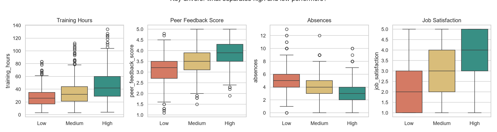 | 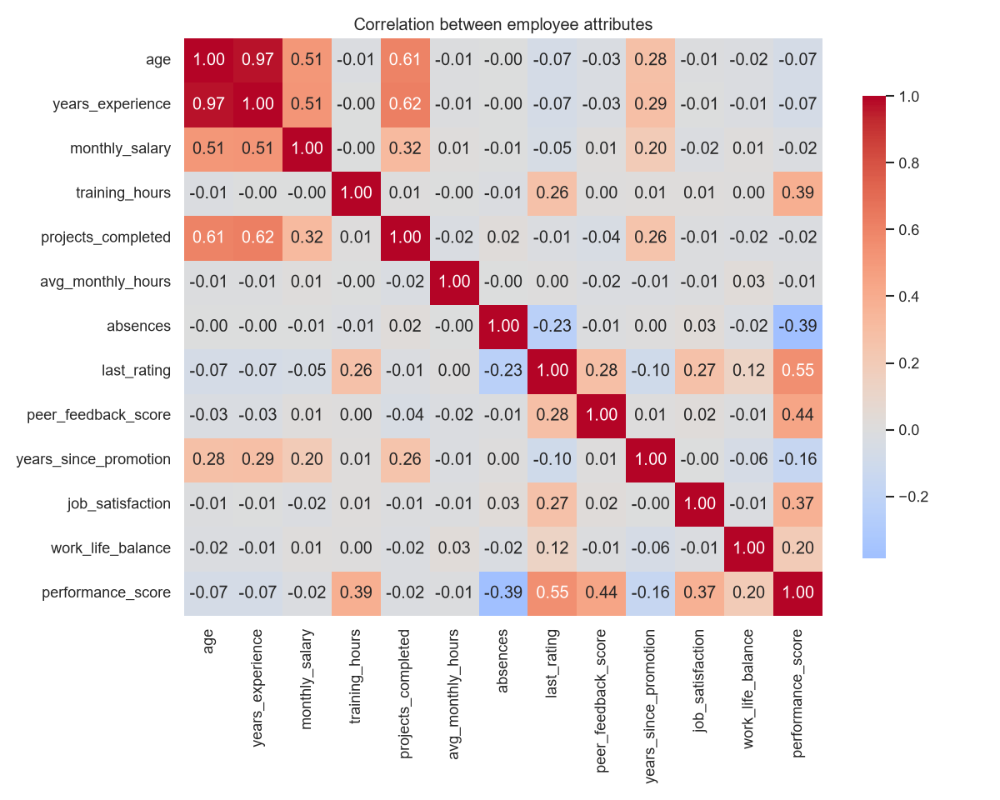 |

| Model comparison | Confusion matrix |
|---|---|
| 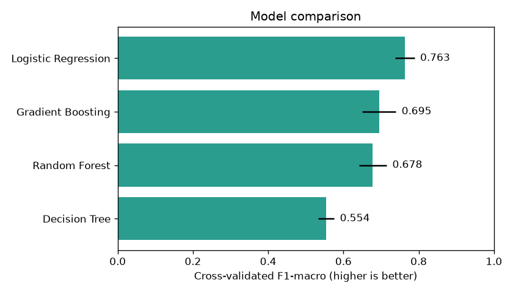 | 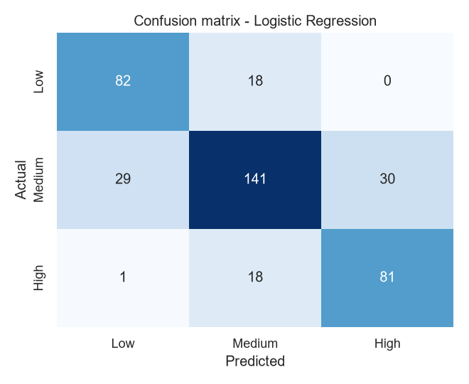 |

| Feature importance | Overtime vs performance |
|---|---|
| 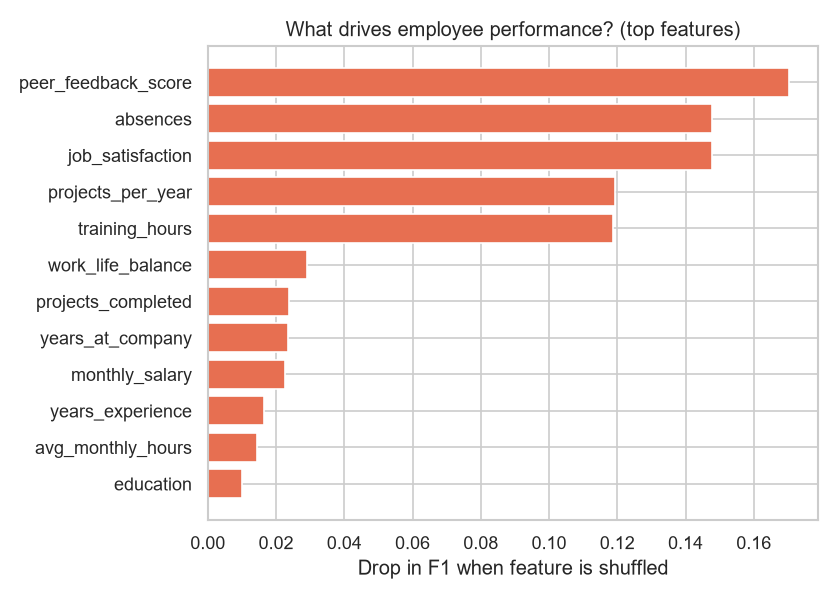 | 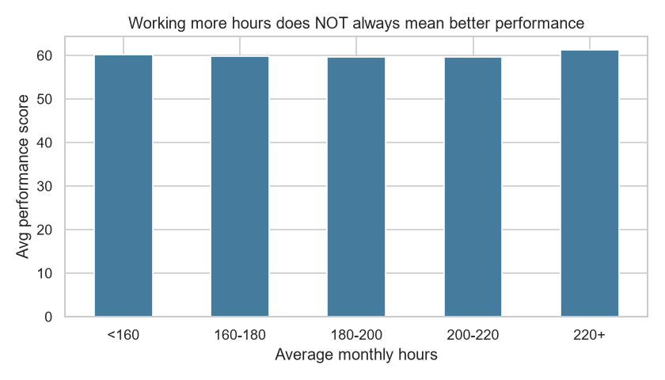 |

### Streamlit dashboard

| Overview | Live prediction |
|---|---|
| 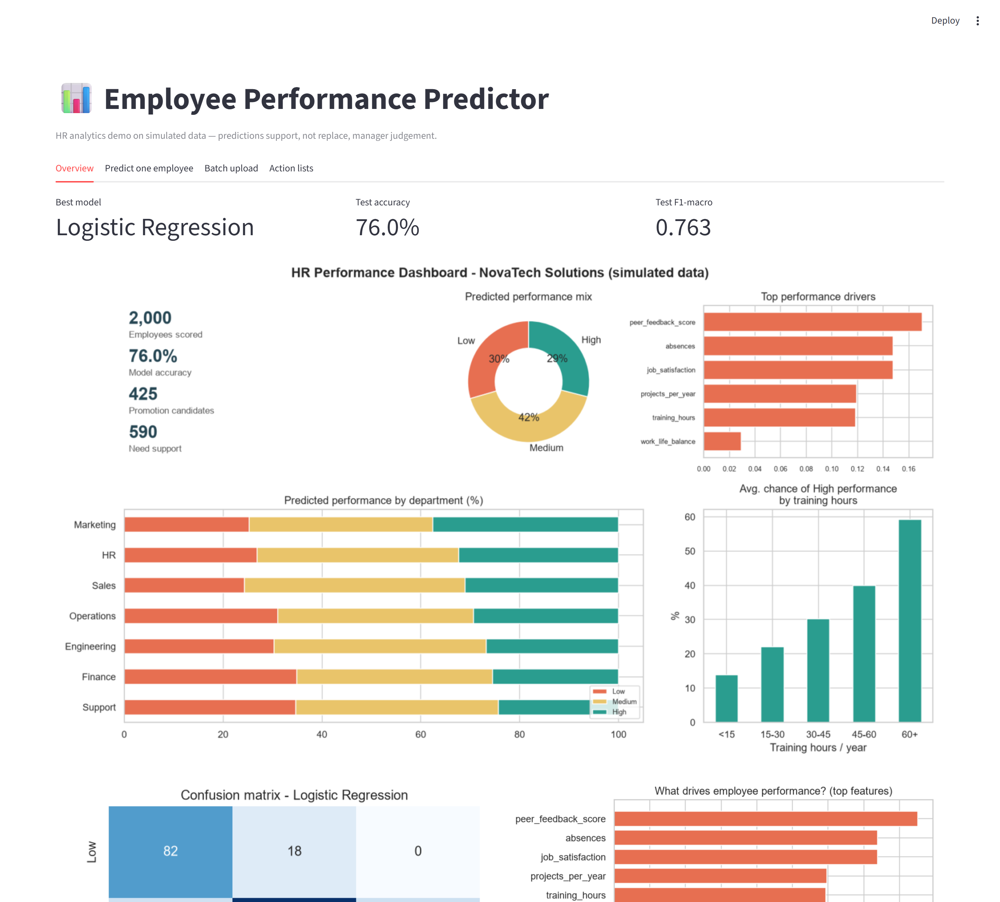 | 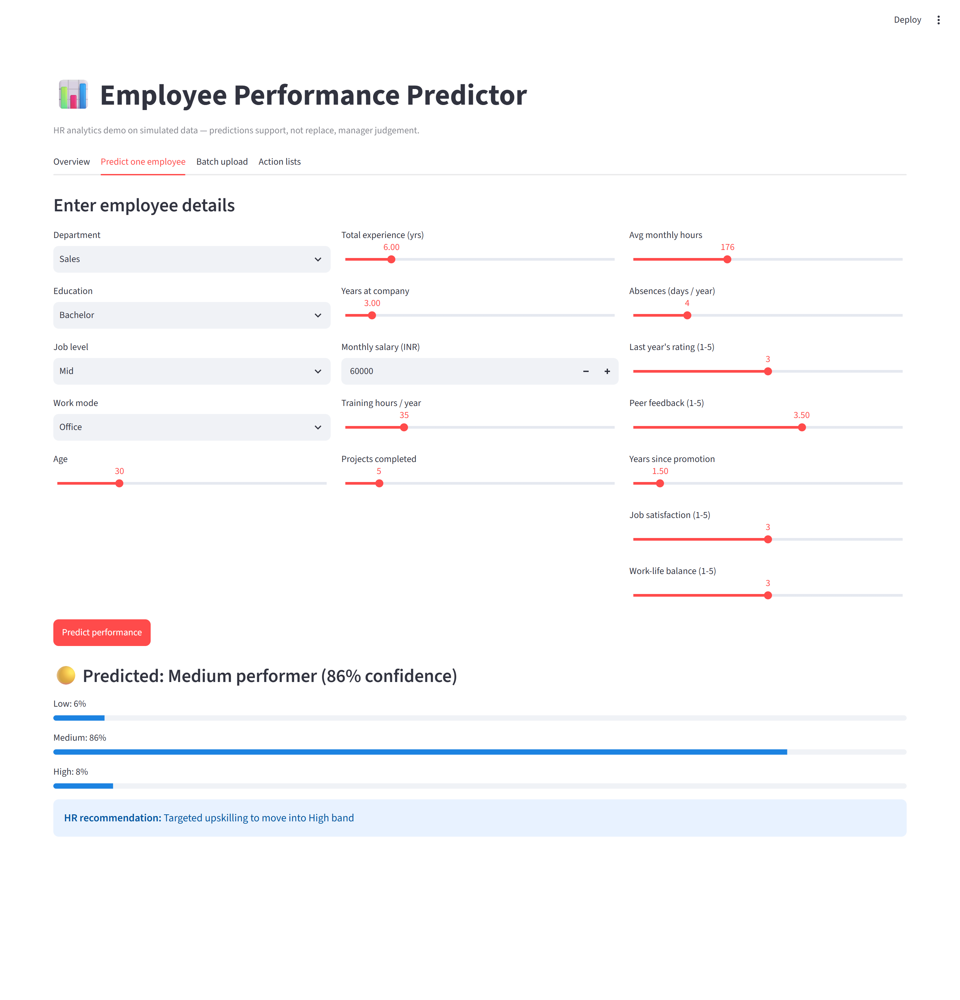 |

| Raw messy data (before cleaning) | Model training output |
|---|---|
| 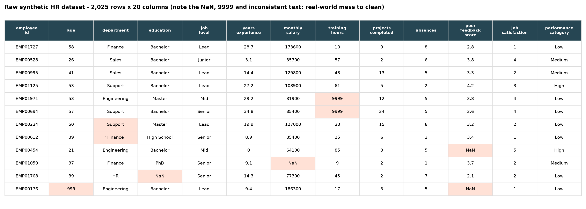 | 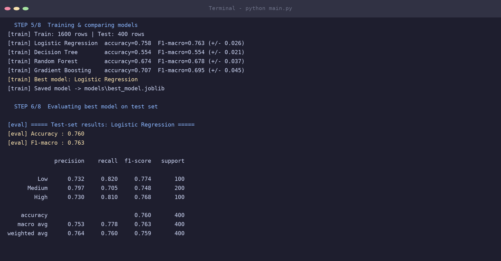 |

**Sample prediction output**

```
employee_id  department  job_level  predicted_category  confidence  hr_recommendation
NEW009       Engineering Junior     High                0.74        Promotion / leadership-track candidate; increase training hours
NEW002       Engineering Senior     Low                 0.71        Performance Improvement Plan + mentor; burnout risk - review workload
```

## 10. Ethics & Limitations

- The data is **synthetic**. The results show the method works; they are not facts about real people.
- Protected attributes (gender, religion, caste, etc.) are deliberately **not used** as features.
- Predictions should **support, not replace** manager judgement. Every flagged employee needs a human review.
- In production, the model would need fairness audits across groups and regular retraining.

## 11. Future Improvements

- Train on a public HR dataset (e.g. IBM HR Analytics on Kaggle)
- Add an employee attrition (resignation) prediction model
- SHAP explanations for each individual prediction
- Deploy the Streamlit app on Streamlit Community Cloud
- Hyper-parameter tuning with GridSearchCV / Optuna, and XGBoost / LightGBM

## 12. Documentation

- 📘 [Full project guide](docs/PROJECT_GUIDE.md): concepts, phases, simulation, troubleshooting
- 🐙 [GitHub & proof-building guide](docs/GITHUB_GUIDE.md)
- 🎤 [Interview preparation](docs/INTERVIEW_PREP.md)

---

**Author:** Sadhanala Nischay Prasad · [GitHub](https://github.com/SNischayPrasad)
